<!-- Keep the panels on one line so the native horizontal scroll area shows one view at a time. -->
<pre><b id="view-desk"><a href="#user-content-view-atlas"><picture><source media="(max-width: 600px)" srcset="https://raw.githubusercontent.com/turutupa/turutupa/main/desk/cards/desk-small-0.webp"><source media="(max-width: 1140px)" srcset="https://raw.githubusercontent.com/turutupa/turutupa/main/desk/cards/desk-mid-0.webp">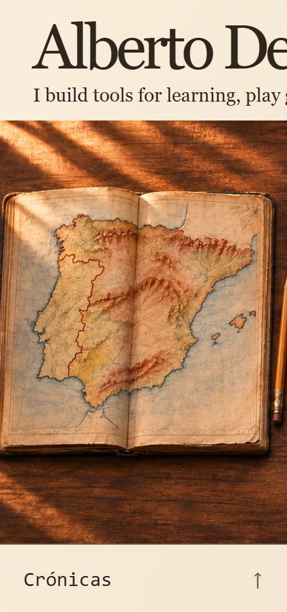</picture></a><a href="#user-content-view-pedal"><picture><source media="(max-width: 600px)" srcset="https://raw.githubusercontent.com/turutupa/turutupa/main/desk/cards/desk-small-1.webp"><source media="(max-width: 1140px)" srcset="https://raw.githubusercontent.com/turutupa/turutupa/main/desk/cards/desk-mid-1.webp">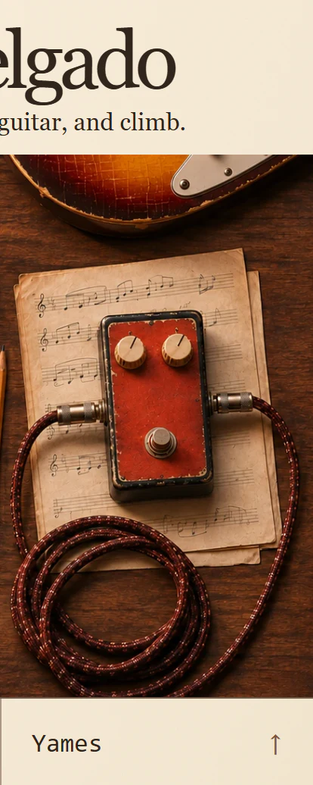</picture></a><a href="#user-content-view-laptop"><picture><source media="(max-width: 600px)" srcset="https://raw.githubusercontent.com/turutupa/turutupa/main/desk/cards/desk-small-2.webp"><source media="(max-width: 1140px)" srcset="https://raw.githubusercontent.com/turutupa/turutupa/main/desk/cards/desk-mid-2.webp">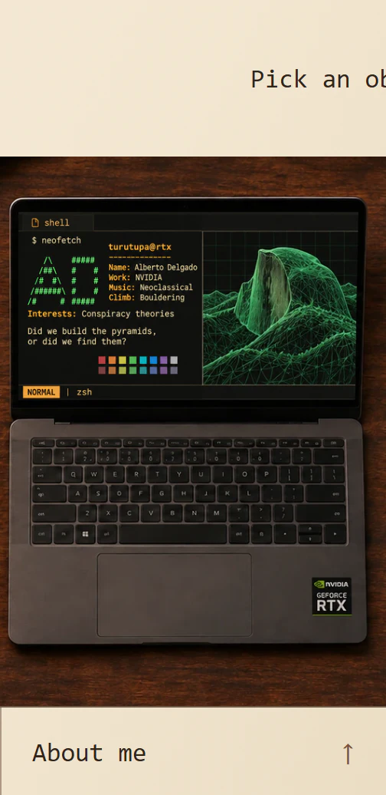</picture></a><a href="#user-content-view-climbing"><picture><source media="(max-width: 600px)" srcset="https://raw.githubusercontent.com/turutupa/turutupa/main/desk/cards/desk-small-3.webp"><source media="(max-width: 1140px)" srcset="https://raw.githubusercontent.com/turutupa/turutupa/main/desk/cards/desk-mid-3.webp">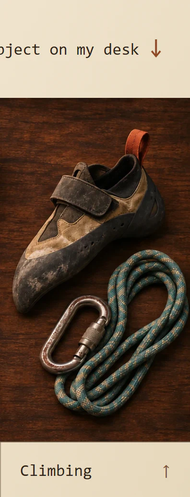</picture></a>  </b>        <b id="view-atlas">  <a href="#user-content-view-desk"><picture><source media="(max-width: 600px)" srcset="https://raw.githubusercontent.com/turutupa/turutupa/main/desk/cards/atlas-small-0.webp"><source media="(max-width: 1140px)" srcset="https://raw.githubusercontent.com/turutupa/turutupa/main/desk/cards/atlas-mid-0.webp">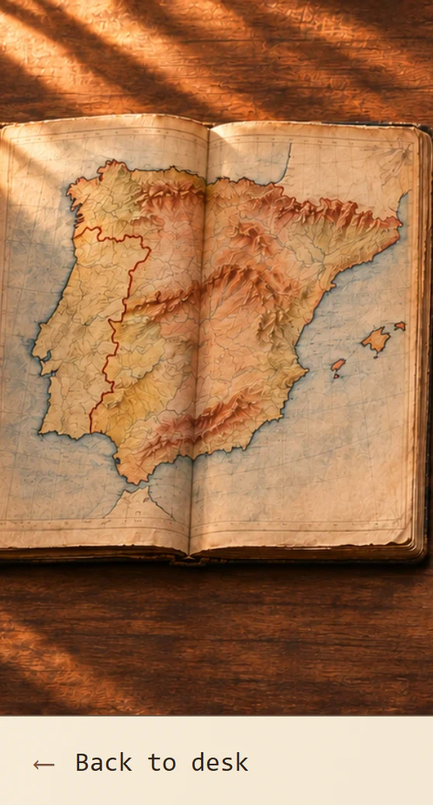</picture></a><a href="https://cronicas.io/"><picture><source media="(max-width: 600px)" srcset="https://raw.githubusercontent.com/turutupa/turutupa/main/desk/cards/atlas-small-1.webp"><source media="(max-width: 1140px)" srcset="https://raw.githubusercontent.com/turutupa/turutupa/main/desk/cards/atlas-mid-1.webp">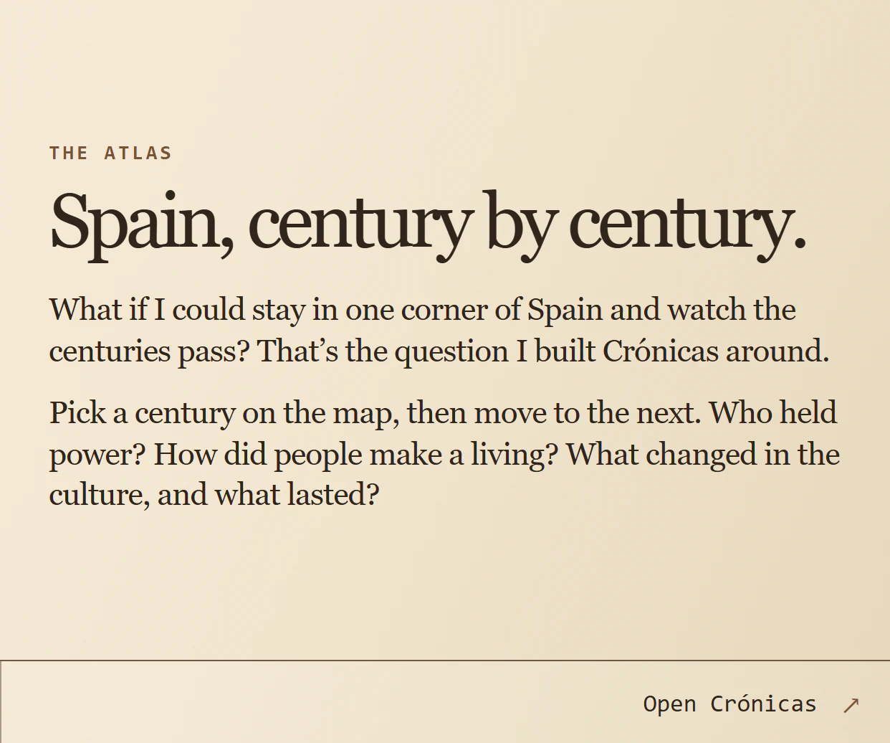</picture></a>  </b>        <b id="view-pedal">  <a href="#user-content-view-desk"><picture><source media="(max-width: 600px)" srcset="https://raw.githubusercontent.com/turutupa/turutupa/main/desk/cards/pedal-small-0.webp"><source media="(max-width: 1140px)" srcset="https://raw.githubusercontent.com/turutupa/turutupa/main/desk/cards/pedal-mid-0.webp">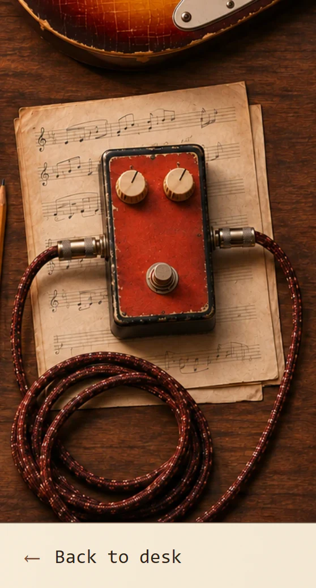</picture></a><a href="https://dev.to/turutupa/yames-yet-another-metronome-everyone-skips-5f49"><picture><source media="(max-width: 600px)" srcset="https://raw.githubusercontent.com/turutupa/turutupa/main/desk/cards/pedal-small-1.webp"><source media="(max-width: 1140px)" srcset="https://raw.githubusercontent.com/turutupa/turutupa/main/desk/cards/pedal-mid-1.webp">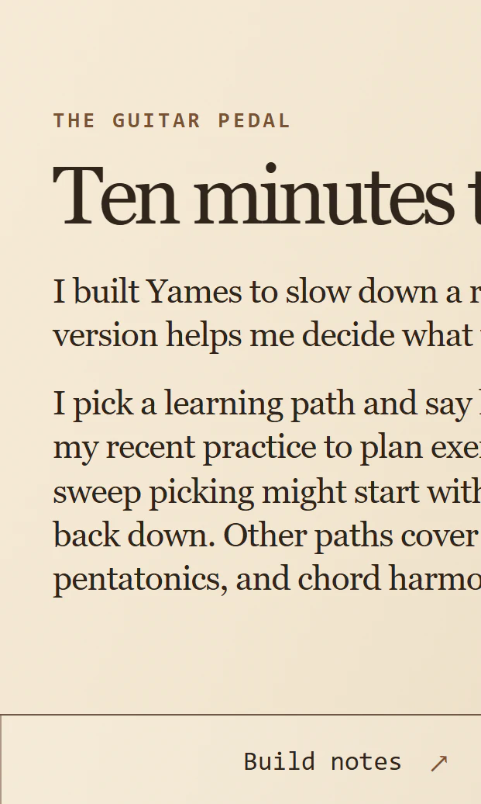</picture></a><a href="https://yames.app/"><picture><source media="(max-width: 600px)" srcset="https://raw.githubusercontent.com/turutupa/turutupa/main/desk/cards/pedal-small-2.webp"><source media="(max-width: 1140px)" srcset="https://raw.githubusercontent.com/turutupa/turutupa/main/desk/cards/pedal-mid-2.webp">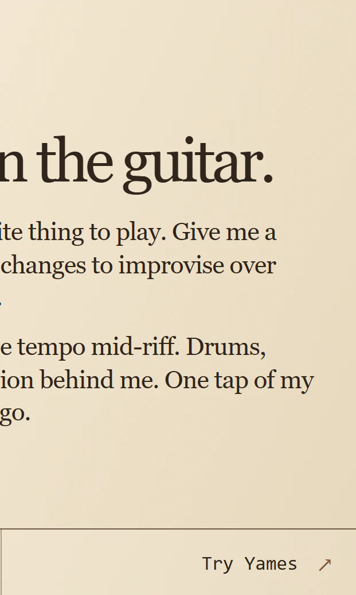</picture></a>  </b>        <b id="view-laptop">  <a href="#user-content-view-desk"><picture><source media="(max-width: 600px)" srcset="https://raw.githubusercontent.com/turutupa/turutupa/main/desk/cards/laptop-small-0.webp"><source media="(max-width: 1140px)" srcset="https://raw.githubusercontent.com/turutupa/turutupa/main/desk/cards/laptop-mid-0.webp">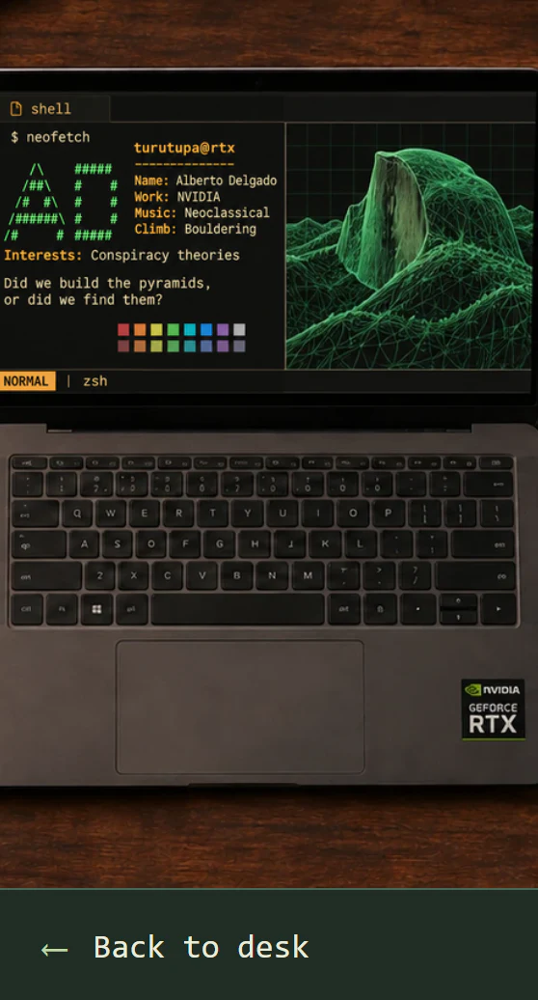</picture></a><a href="#user-content-view-climbing"><picture><source media="(max-width: 600px)" srcset="https://raw.githubusercontent.com/turutupa/turutupa/main/desk/cards/laptop-small-1.webp"><source media="(max-width: 1140px)" srcset="https://raw.githubusercontent.com/turutupa/turutupa/main/desk/cards/laptop-mid-1.webp">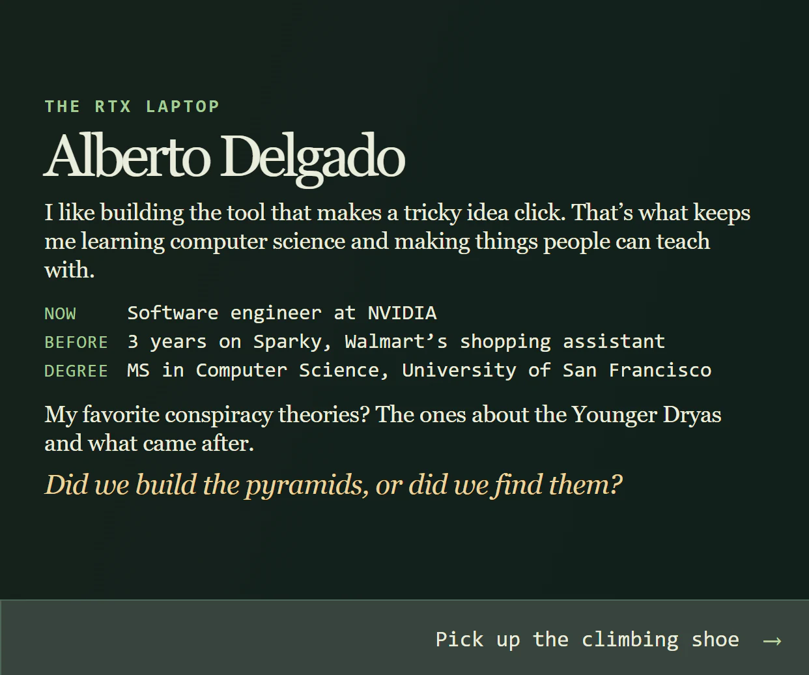</picture></a>  </b>        <b id="view-climbing">  <a href="#user-content-view-desk"><picture><source media="(max-width: 600px)" srcset="https://raw.githubusercontent.com/turutupa/turutupa/main/desk/cards/climbing-small-0.webp"><source media="(max-width: 1140px)" srcset="https://raw.githubusercontent.com/turutupa/turutupa/main/desk/cards/climbing-mid-0.webp">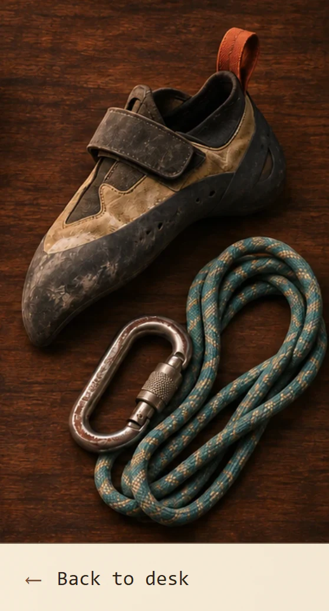</picture></a><a href="#user-content-view-laptop"><picture><source media="(max-width: 600px)" srcset="https://raw.githubusercontent.com/turutupa/turutupa/main/desk/cards/climbing-small-1.webp"><source media="(max-width: 1140px)" srcset="https://raw.githubusercontent.com/turutupa/turutupa/main/desk/cards/climbing-mid-1.webp">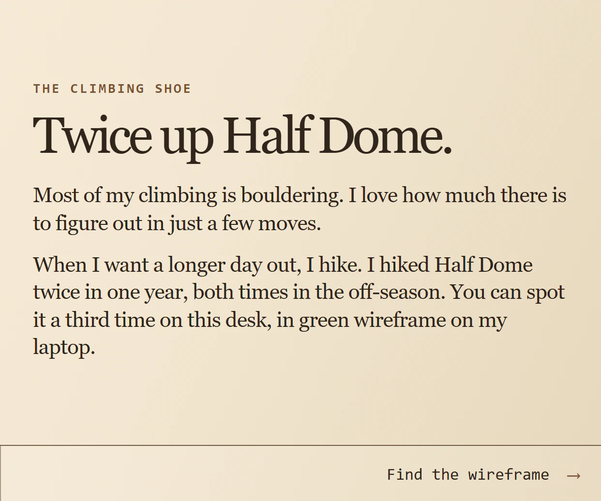</picture></a>  </b></pre>
