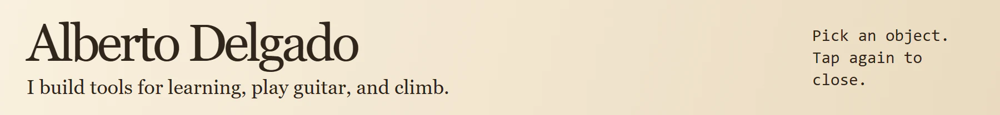
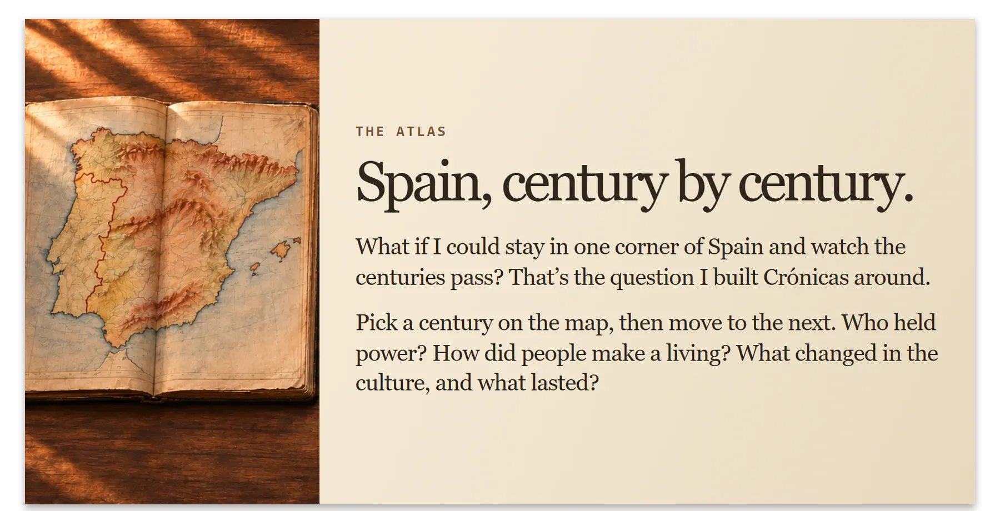
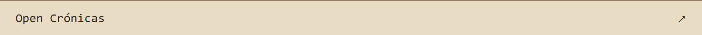
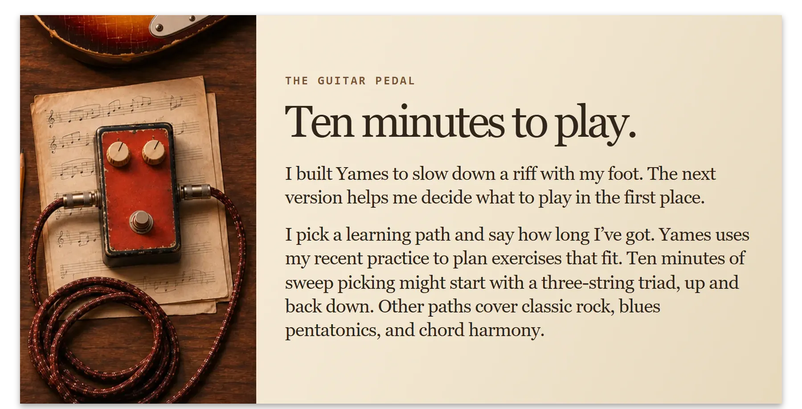
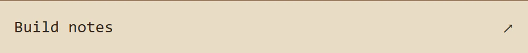
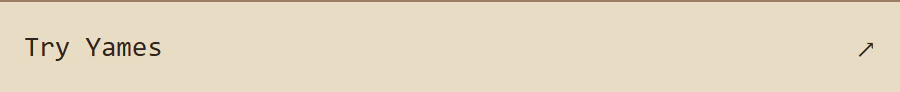
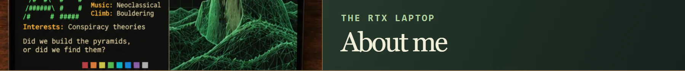
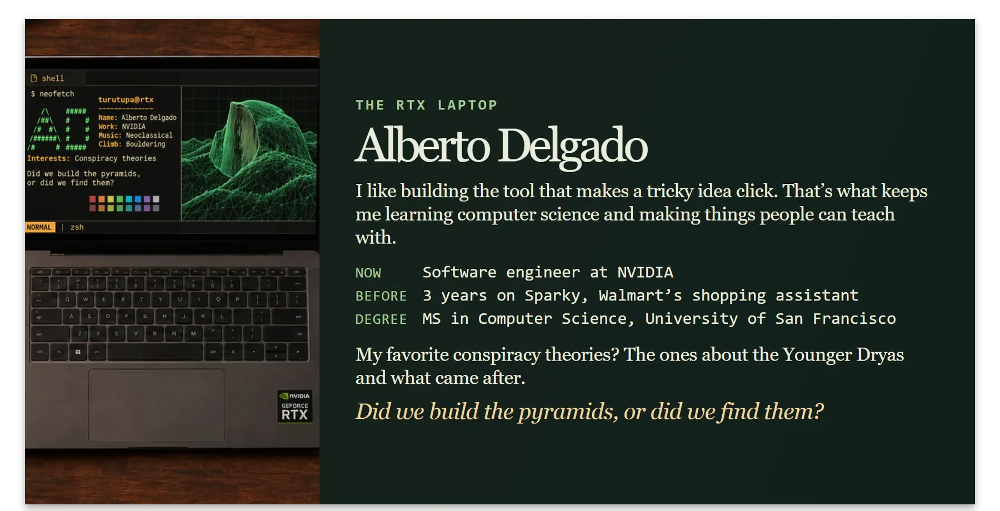
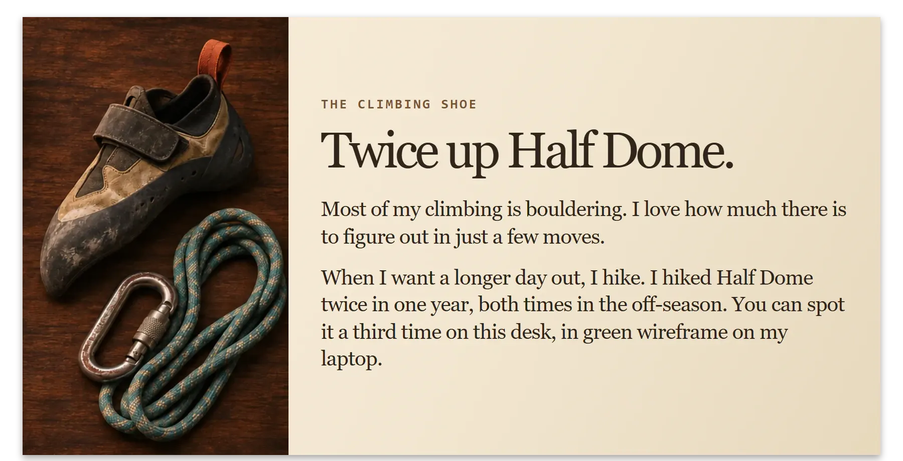

&emsp;<picture><source media="(max-width: 600px)" srcset="https://raw.githubusercontent.com/turutupa/turutupa/main/desk/drawers/head-small.webp"><source media="(max-width: 1140px)" srcset="https://raw.githubusercontent.com/turutupa/turutupa/main/desk/drawers/head-mid.webp"></picture>

<picture><source media="(max-width: 600px)" srcset="https://raw.githubusercontent.com/turutupa/turutupa/main/desk/drawers/atlas-small-handle.webp"><source media="(max-width: 1140px)" srcset="https://raw.githubusercontent.com/turutupa/turutupa/main/desk/drawers/atlas-mid-handle.webp"></picture>

&emsp;<picture><source media="(prefers-reduced-motion: reduce) and (max-width: 600px)" srcset="https://raw.githubusercontent.com/turutupa/turutupa/main/desk/drawers/atlas-small-static.webp"><source media="(prefers-reduced-motion: reduce) and (max-width: 1140px)" srcset="https://raw.githubusercontent.com/turutupa/turutupa/main/desk/drawers/atlas-mid-static.webp"><source media="(prefers-reduced-motion: reduce)" srcset="https://raw.githubusercontent.com/turutupa/turutupa/main/desk/drawers/atlas-wide-static.webp"><source media="(max-width: 600px)" srcset="https://raw.githubusercontent.com/turutupa/turutupa/main/desk/drawers/atlas-small-motion.webp"><source media="(max-width: 1140px)" srcset="https://raw.githubusercontent.com/turutupa/turutupa/main/desk/drawers/atlas-mid-motion.webp"></picture>

&emsp;<a href="https://cronicas.io/" target="_blank" rel="noopener noreferrer"><picture><source media="(max-width: 600px)" srcset="https://raw.githubusercontent.com/turutupa/turutupa/main/desk/drawers/atlas-small-link-0.webp"><source media="(max-width: 1140px)" srcset="https://raw.githubusercontent.com/turutupa/turutupa/main/desk/drawers/atlas-mid-link-0.webp"></picture></a>

<picture><source media="(max-width: 600px)" srcset="https://raw.githubusercontent.com/turutupa/turutupa/main/desk/drawers/pedal-small-handle.webp"><source media="(max-width: 1140px)" srcset="https://raw.githubusercontent.com/turutupa/turutupa/main/desk/drawers/pedal-mid-handle.webp"></picture>

&emsp;<picture><source media="(prefers-reduced-motion: reduce) and (max-width: 600px)" srcset="https://raw.githubusercontent.com/turutupa/turutupa/main/desk/drawers/pedal-small-static.webp"><source media="(prefers-reduced-motion: reduce) and (max-width: 1140px)" srcset="https://raw.githubusercontent.com/turutupa/turutupa/main/desk/drawers/pedal-mid-static.webp"><source media="(prefers-reduced-motion: reduce)" srcset="https://raw.githubusercontent.com/turutupa/turutupa/main/desk/drawers/pedal-wide-static.webp"><source media="(max-width: 600px)" srcset="https://raw.githubusercontent.com/turutupa/turutupa/main/desk/drawers/pedal-small-motion.webp"><source media="(max-width: 1140px)" srcset="https://raw.githubusercontent.com/turutupa/turutupa/main/desk/drawers/pedal-mid-motion.webp"></picture>

&emsp;<a href="https://dev.to/turutupa/yames-yet-another-metronome-everyone-skips-5f49" target="_blank" rel="noopener noreferrer"><picture><source media="(max-width: 600px)" srcset="https://raw.githubusercontent.com/turutupa/turutupa/main/desk/drawers/pedal-small-link-0.webp"><source media="(max-width: 1140px)" srcset="https://raw.githubusercontent.com/turutupa/turutupa/main/desk/drawers/pedal-mid-link-0.webp"></picture></a><a href="https://yames.app/" target="_blank" rel="noopener noreferrer"><picture><source media="(max-width: 600px)" srcset="https://raw.githubusercontent.com/turutupa/turutupa/main/desk/drawers/pedal-small-link-1.webp"><source media="(max-width: 1140px)" srcset="https://raw.githubusercontent.com/turutupa/turutupa/main/desk/drawers/pedal-mid-link-1.webp"></picture></a>

<picture><source media="(max-width: 600px)" srcset="https://raw.githubusercontent.com/turutupa/turutupa/main/desk/drawers/laptop-small-handle.webp"><source media="(max-width: 1140px)" srcset="https://raw.githubusercontent.com/turutupa/turutupa/main/desk/drawers/laptop-mid-handle.webp"></picture>

&emsp;<picture><source media="(prefers-reduced-motion: reduce) and (max-width: 600px)" srcset="https://raw.githubusercontent.com/turutupa/turutupa/main/desk/drawers/laptop-small-static.webp"><source media="(prefers-reduced-motion: reduce) and (max-width: 1140px)" srcset="https://raw.githubusercontent.com/turutupa/turutupa/main/desk/drawers/laptop-mid-static.webp"><source media="(prefers-reduced-motion: reduce)" srcset="https://raw.githubusercontent.com/turutupa/turutupa/main/desk/drawers/laptop-wide-static.webp"><source media="(max-width: 600px)" srcset="https://raw.githubusercontent.com/turutupa/turutupa/main/desk/drawers/laptop-small-motion.webp"><source media="(max-width: 1140px)" srcset="https://raw.githubusercontent.com/turutupa/turutupa/main/desk/drawers/laptop-mid-motion.webp"></picture>

<picture><source media="(max-width: 600px)" srcset="https://raw.githubusercontent.com/turutupa/turutupa/main/desk/drawers/climbing-small-handle.webp"><source media="(max-width: 1140px)" srcset="https://raw.githubusercontent.com/turutupa/turutupa/main/desk/drawers/climbing-mid-handle.webp"></picture>

&emsp;<picture><source media="(prefers-reduced-motion: reduce) and (max-width: 600px)" srcset="https://raw.githubusercontent.com/turutupa/turutupa/main/desk/drawers/climbing-small-static.webp"><source media="(prefers-reduced-motion: reduce) and (max-width: 1140px)" srcset="https://raw.githubusercontent.com/turutupa/turutupa/main/desk/drawers/climbing-mid-static.webp"><source media="(prefers-reduced-motion: reduce)" srcset="https://raw.githubusercontent.com/turutupa/turutupa/main/desk/drawers/climbing-wide-static.webp"><source media="(max-width: 600px)" srcset="https://raw.githubusercontent.com/turutupa/turutupa/main/desk/drawers/climbing-small-motion.webp"><source media="(max-width: 1140px)" srcset="https://raw.githubusercontent.com/turutupa/turutupa/main/desk/drawers/climbing-mid-motion.webp"></picture>

