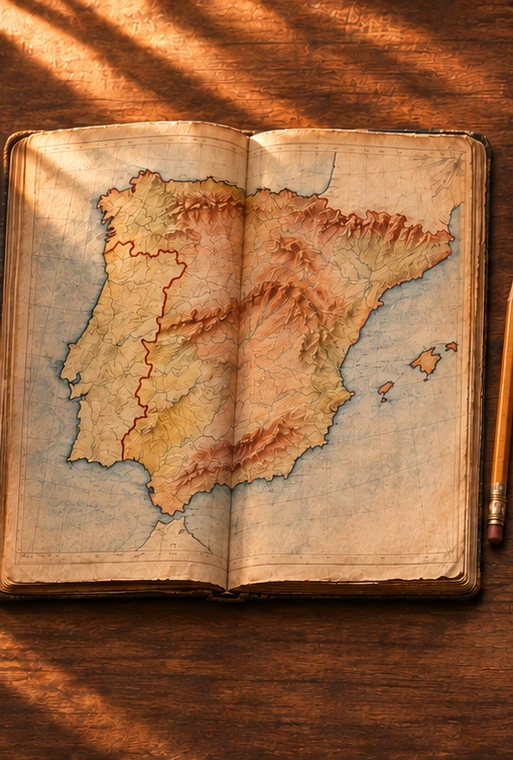
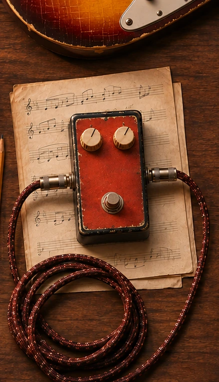
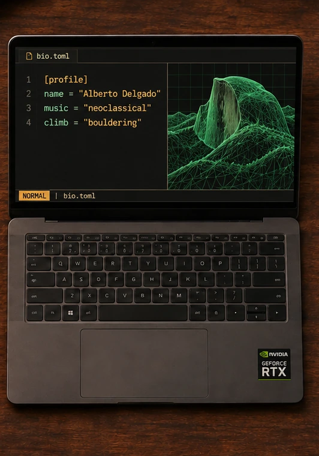
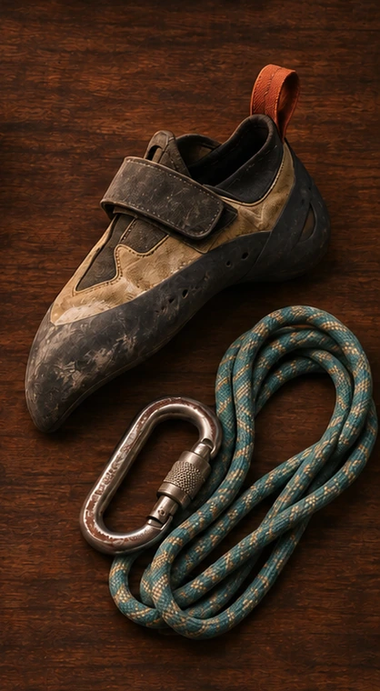

# Alberto Delgado

I build tools for learning, play guitar, and climb. Pick an object on my desk to open its story.

<strong>The atlas</strong> · Crónicas

What changes when you keep the place fixed and move through time? In Crónicas, you can explore Spain on a map and move through the centuries to see how its politics, economy, and culture changed.

[Explore Crónicas](https://cronicas.io/)

<strong>The guitar pedal</strong> · Yames

Neoclassical is my favorite style to play on guitar. I also love metal, rock ’n’ roll, and improvising over a chord progression.

I wanted a better metronome for practice, so I wrote my own. With Yames I can loop a progression with drums, bass, and keys, then change the tempo with a footswitch while I keep playing.

[Try Yames](https://yames.app/) · [Why I built it](https://dev.to/turutupa/yames-yet-another-metronome-everyone-skips-5f49)

<strong>The RTX laptop</strong> · About me

I’m a software engineer at NVIDIA. Before that, I spent three years at Walmart working on Sparky, its shopping assistant. I earned my master’s in computer science at the University of San Francisco.

I still love learning about computer science. My favorite tools to build are the ones someone can use to learn something for themselves or teach it to somebody else.

[My writing](https://dev.to/turutupa)

I love a good conspiracy theory. My favorite rabbit hole is the Younger Dryas, what came after it, and the stories people tell about that stretch of time.

*Did we build the pyramids, or did we find them?*

<strong>The climbing shoe</strong> · Bouldering and Half Dome

Most of my climbing is bouldering. I love hiking, too. I hiked Half Dome twice in one year, both times in the off-season. That’s the mountain drawn in wireframe on my laptop screen.

