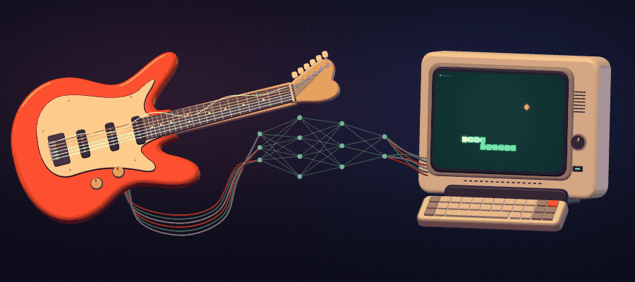

# Alberto Delgado

<a href="https://turutupa.github.io/turutupa/">
  <picture>
    <source media="(prefers-reduced-motion: reduce)" srcset="./docs/poster.webp">
    
  </picture>
</a>

**[Play Feedback Loop ↗](https://turutupa.github.io/turutupa/)**

Pluck a string with keys 1–6, follow the pulse through the circuit, then take over the game of Snake.

[Crónicas](https://cronicas.io/) · [Yames](https://yames.app/)
